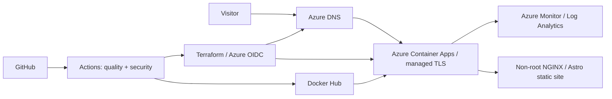

# aliberkyildiz.com

Production-grade personal portfolio and live DevOps/SRE case study. Astro
generates a static site, a minimal non-root NGINX container serves it, GitHub
Actions publishes immutable images to Docker Hub, and Terraform provisions
Azure Container Apps, Azure DNS and bounded observability.

> **Cost decision:** Container Apps Consumption replaces the original AKS
> runtime for production. It retains container, revision, probe, IaC and
> observability practices while removing the permanent VM and load-balancer
> cost. The Helm/AKS implementation remains in the repository as a portability
> reference.

## Architecture



## Repository

```text
.
├── src/                         Astro pages, layouts and profile content
├── public/                      Static assets
├── tests/                       Content contract tests
├── helm/portfolio/              Optional Kubernetes portability reference
├── terraform/
│   ├── bootstrap/               One-time remote-state storage
│   ├── environments/            Environment-specific variables
│   └── modules/                 Container Apps, DNS and monitoring
├── observability/               Queries, alert guidance and runbook
├── docs/                        Architecture and cost case study
└── .github/workflows/           CI, security, Terraform and release delivery
```

## Local development

Requirements: Node.js 22 and pnpm 11.

```bash
pnpm install --frozen-lockfile
pnpm dev
```

Quality checks:

```bash
pnpm format
pnpm lint
pnpm test
pnpm build
pnpm audit --audit-level=high
pnpm test:lighthouse
```

Container:

```bash
docker build -t portfolio:local .
docker run --rm -p 8080:8080 portfolio:local
curl --fail http://localhost:8080/healthz
```

## Infrastructure deployment

1. Bootstrap the Terraform state account with `terraform/bootstrap`.
2. Copy `terraform/backend.hcl.example` to ignored `terraform/backend.hcl`.
3. Run `terraform plan` and `terraform apply` with
   `environments/prod.tfvars`.
4. Delegate `aliberkyildiz.com` at the registrar to the four Azure DNS name
   servers from Terraform output.
5. Bind apex and `www` with the release workflow. Azure issues and renews the
   free managed certificates.

Azure DNS is sufficient as authoritative DNS. Cloudflare is intentionally
omitted; add a CDN/WAF only after traffic or security requirements justify it.

## GitHub configuration

Use GitHub OIDC federation for Azure; do not store an Azure client secret.

| Name                       | Scope            | Purpose                       |
| -------------------------- | ---------------- | ----------------------------- |
| `AZURE_CLIENT_ID`          | plan, production | Federated deployment identity |
| `AZURE_TENANT_ID`          | plan, production | Azure tenant                  |
| `AZURE_SUBSCRIPTION_ID`    | plan, production | Azure subscription            |
| `TF_STATE_STORAGE_ACCOUNT` | plan, production | Remote state                  |
| `DOCKERHUB_USERNAME`       | production       | Image repository              |
| `DOCKERHUB_TOKEN`          | production       | Least-privilege push token    |

Protect `main` with pull requests, one approval, required quality/security
checks, resolved conversations, linear history and no force pushes. Require
reviewers on the `production` environment before Terraform apply and deploy.

## Releases

Branches use `feature/*`, `fix/*`, and `infra/*`; commits follow Conventional
Commits. A SemVer tag such as `v1.0.0` publishes an SBOM/provenance-enabled
Docker Hub image, updates the Container App revision, binds managed
certificates and runs a production smoke test.

## Documentation

- [Architecture decisions](docs/architecture.md)
- [Cost optimization case study](docs/cost-optimization.md)
- [Operations runbook](observability/README.md)
- [Contributing](CONTRIBUTING.md)
- [Production readiness checklist](docs/production-readiness.md)
