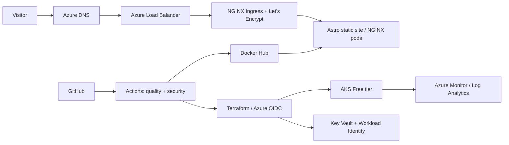

# aliberkyildiz.com

Production-grade personal portfolio and a live DevOps/SRE case study. The site
is statically generated with Astro, served from a minimal non-root NGINX
container, deployed to AKS with Helm, and provisioned with Terraform.

> **Cost reality:** AKS is deliberately used to demonstrate platform
> engineering skills. It is not the cheapest way to host a static portfolio.
> Azure Static Web Apps or Azure Container Apps is the recommended
> cost-optimized production alternative.

## Architecture



## Repository

```text
.
├── src/                         Astro pages, layouts and editable content
├── public/                      Static assets
├── tests/                       Content contract tests
├── helm/portfolio/              Deployment, Service, Ingress, HPA and policies
├── terraform/
│   ├── bootstrap/               One-time remote-state storage
│   ├── environments/            Environment-specific variables
│   └── modules/                 AKS, network, DNS, identity, vault, monitoring
├── observability/               Queries, alert guidance and runbook
├── docs/                        Architecture and cost case study
└── .github/workflows/           CI, security, Terraform, release and deployment
```

## Local development

Requirements: Node.js 22 and pnpm 11.

```bash
pnpm install --frozen-lockfile
pnpm dev
```

Quality checks:

```bash
pnpm format
pnpm lint
pnpm test
pnpm build
pnpm test:lighthouse
```

Container:

```bash
docker build -t portfolio:local .
docker run --rm -p 8080:8080 portfolio:local
curl --fail http://localhost:8080/healthz
```

## Infrastructure deployment

1. Bootstrap the state account:

   ```bash
   cd terraform/bootstrap
   terraform init
   terraform apply
   ```

2. Copy `terraform/backend.hcl.example` to the ignored
   `terraform/backend.hcl`, fill the bootstrap outputs, then:

   ```bash
   cd terraform
   terraform init -backend-config=backend.hcl
   terraform plan -var-file=environments/prod.tfvars
   terraform apply -var-file=environments/prod.tfvars
   ```

3. Delegate `aliberkyildiz.com` at the domain registrar to the four Azure DNS
   name servers from the Terraform output.

4. Install ingress, cert-manager and the chart. The release workflow performs
   these commands automatically after credentials are configured.

5. Terraform creates a static public IP plus apex and `www` A records. The
   release workflow assigns that reserved IP to NGINX Ingress.

## GitHub configuration

Use GitHub OIDC federation for Azure; do not create an Azure client secret.

Repository/environment secrets:

| Name                       | Scope            | Purpose                          |
| -------------------------- | ---------------- | -------------------------------- |
| `AZURE_CLIENT_ID`          | plan, production | Federated deployment identity    |
| `AZURE_TENANT_ID`          | plan, production | Azure tenant                     |
| `AZURE_SUBSCRIPTION_ID`    | plan, production | Azure subscription               |
| `TF_STATE_STORAGE_ACCOUNT` | plan, production | Remote state                     |
| `DOCKERHUB_USERNAME`       | production       | Image repository                 |
| `DOCKERHUB_TOKEN`          | production       | Least-privilege Docker Hub token |

Environment variables:

| Name                          | Purpose                             |
| ----------------------------- | ----------------------------------- |
| `AZURE_RESOURCE_GROUP`        | AKS resource group                  |
| `AKS_CLUSTER_NAME`            | Target cluster                      |
| `WORKLOAD_IDENTITY_CLIENT_ID` | Pod federation annotation           |
| `INGRESS_PUBLIC_IP`           | Terraform-managed static ingress IP |

Protect `main` with:

- pull requests and one approval;
- required `Lint, test, build`, security, CodeQL, Helm and Terraform checks;
- resolved conversations and linear history;
- no direct pushes or force pushes;
- `production` environment required reviewers for Terraform apply/deploy.

GitHub administrators must configure these settings in repository settings;
files in a repository cannot enforce branch protection by themselves.

## Releases

Branches: `feature/*`, `fix/*`, and `infra/*`. Commit messages follow
Conventional Commits (`feat:`, `fix:`, `infra:`, `docs:`, `chore:`).

Create a SemVer tag such as `v1.0.0`. The release workflow builds an immutable,
SBOM/provenance-enabled image, pushes it to Docker Hub, creates release notes,
deploys with Helm `--atomic`, and executes a production smoke test.

## Documentation

- [Architecture decisions](docs/architecture.md)
- [Cost optimization case study](docs/cost-optimization.md)
- [Operations runbook](observability/README.md)
- [Contributing](CONTRIBUTING.md)
- [Production readiness checklist](docs/production-readiness.md)

## Known pre-production inputs

The repository intentionally does not invent personal history. Update
`src/data/site.ts`, `src/data/projects.ts`, the CV link, social profiles and
real case-study metrics before public launch. Azure and Docker Hub credentials
are also required before infrastructure can be applied.
